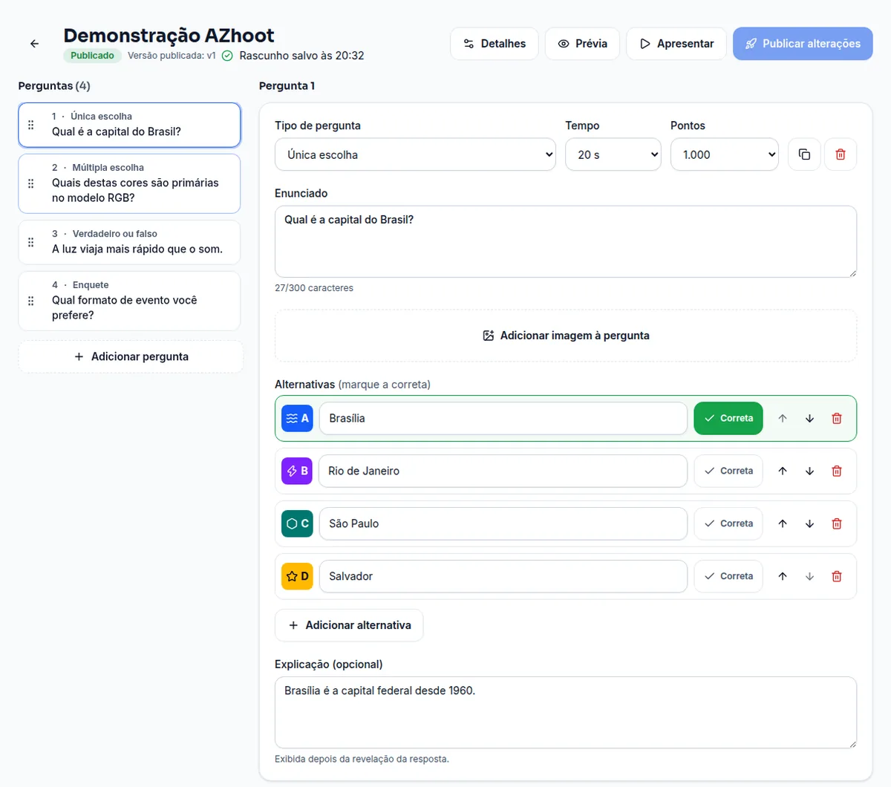
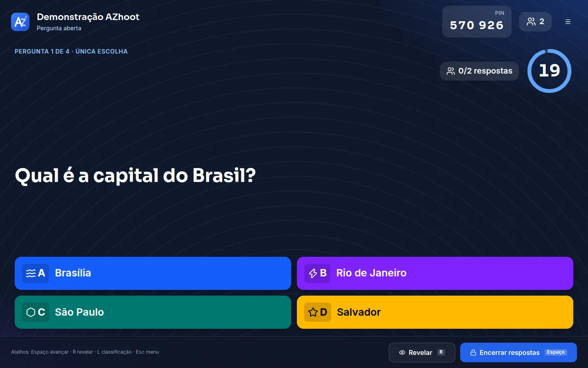
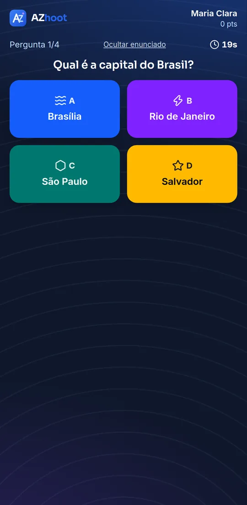
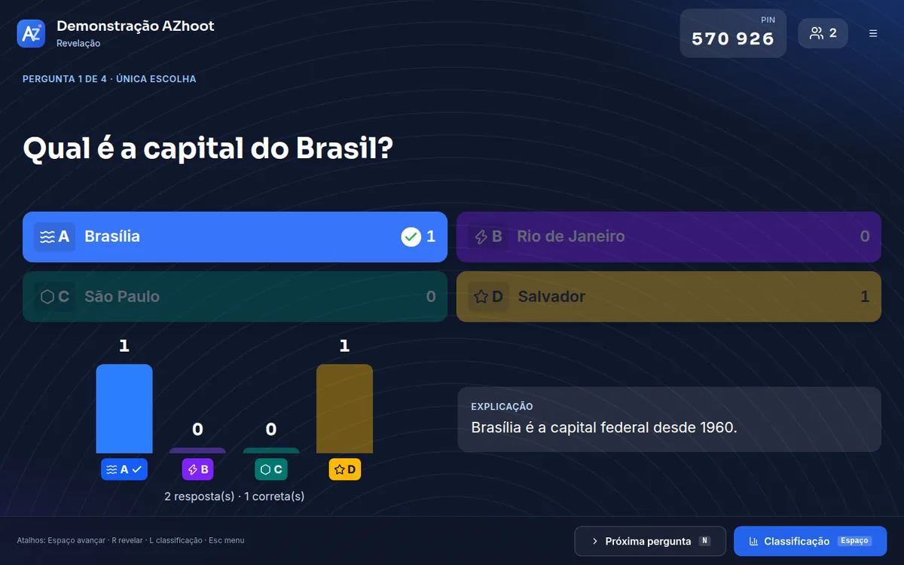
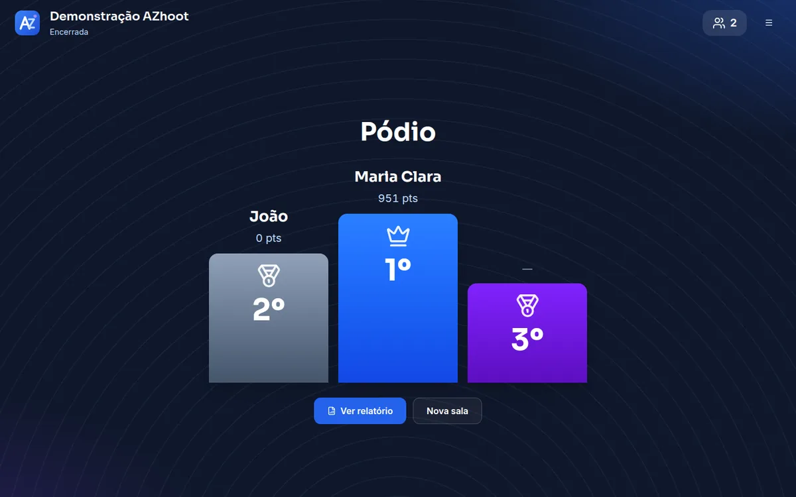
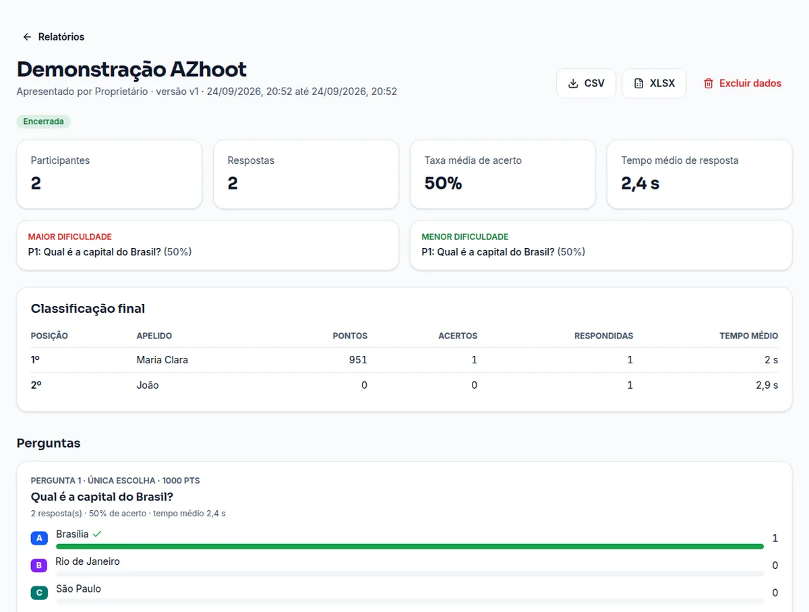

<div align="center">


# AZhoot

**Plataforma de quizzes e apresentações interativas em tempo real — "de A a Z".**
O apresentador cria um quiz, abre uma sala e compartilha um **PIN de 6 dígitos** (ou QR Code);
o público entra pelo celular só com um apelido, responde e acompanha **ranking e pódio ao vivo**.

[](https://github.com/thiagoamgomes/panda-azhoot/actions/workflows/ci.yml)


</div>

---

## Índice

- [O que é](#o-que-é)
- [Telas](#telas)
- [Principais recursos](#principais-recursos)
- [Planos (SaaS)](#planos-saas)
- [Arquitetura](#arquitetura)
- [Stack e versões](#stack-e-versões)
- [Instalação (desenvolvimento)](#instalação-desenvolvimento)
- [Deploy em produção (Docker)](#deploy-em-produção-docker)
- [Variáveis de ambiente](#variáveis-de-ambiente)
- [Comandos](#comandos)
- [Testes e qualidade](#testes-e-qualidade)
- [Segurança](#segurança)
- [Estrutura do projeto](#estrutura-do-projeto)
- [Licença](#licença)

---

## O que é

O **AZhoot** (pronuncia-se _Azute_) é um SaaS multi-conta em **português do Brasil** para
tornar apresentações interativas em eventos, aulas, treinamentos, reuniões e dinâmicas.

- O **apresentador** cria quizzes, abre uma sala e controla a partida numa tela 16:9.
- Os **participantes** entram pelo navegador do celular — sem instalar app e sem criar conta.
- O **servidor** é a autoridade: controla cronômetro, valida respostas e calcula a pontuação.
- O **dono da plataforma** administra tudo pelo painel master (`/master`): contas, receitas,
  despesas, analíticos, afiliados e configurações.

## Telas

|                                                                                                      |                                                                                    |
| ---------------------------------------------------------------------------------------------------- | ---------------------------------------------------------------------------------- |
| **Editor de quiz** — tipos de pergunta, tempo, pontos, imagem, autosave e publicação versionada      | **Apresentação (16:9)** — pergunta, cronômetro e progresso ao vivo                 |
|                                |  |
| **Participante (mobile)** — responde com uma mão                                                     | **Revelação** — resposta certa e distribuição                                      |
|  |    |
| **Pódio** — top 3 e classificação                                                                    | **Relatório** — totais, acertos e exportação CSV/XLSX                              |
|                                          |                |

## Principais recursos

- 🎮 **Salas ao vivo** com PIN de 6 dígitos e QR Code; entrada sem cadastro.
- ❓ **4 tipos de pergunta**: única escolha, múltipla escolha, verdadeiro/falso e enquete.
- ⏱️ **Tempo real** com Socket.IO — cronômetro, respostas, revelação, ranking e pódio sincronizados; reconexão resiliente (até ~200 participantes por sala).
- 🧮 **Pontuação no servidor** (o cliente nunca informa pontos); resultados individuais privados.
- ✍️ **Editor** com arrastar-e-soltar, autosave, upload de imagem (re-codificada em WebP) e prévia.
- 📊 **Relatórios** com totais e exportação em **CSV** e **XLSX**.
- 🤖 **Geração de perguntas com IA** (OpenAI): por tema, nível e conteúdo/fontes, com upload de **PDF, DOCX, Excel e imagem**. Uso por **créditos** (grátis por plano + pacotes avulsos).
- 💳 **SaaS completo**: cadastro público, planos, cobrança recorrente via **Asaas** (PIX, boleto e cartão), programa de **afiliados** e **painel master**.
- ♿ **Acessível** (axe AA) e responsivo; tema claro/escuro.

## Planos (SaaS)

| Plano    | Preço        | Quizzes    | Pessoas por sessão | Usuários | Créditos de IA |
| -------- | ------------ | ---------- | ------------------ | -------- | -------------- |
| Gratuito | R$ 0         | 5          | 5                  | 1        | 3              |
| Mensal   | R$ 10,00/mês | 20         | 20                 | 3        | 20             |
| Anual    | R$ 99,00/ano | ilimitados | 200                | 10       | 100            |

> Valores, limites e créditos são **editáveis no painel master** (e podem ter exceção por conta).
> Planos pagos exigem valor mínimo aceito pelo provedor de pagamento.

## Arquitetura

Monorepo **pnpm + Turborepo**. A API é a fonte de verdade do estado da sala; o Postgres guarda
dados duráveis e o Redis guarda presença, locks e estado transitório.

```
┌─────────────┐        REST /api/v1          ┌──────────────┐
│   apps/web   │  ───────────────────────▶   │   apps/api    │
│  React SPA   │        WebSocket /game        │  Express +    │
│ (admin,      │  ◀───────────────────────▶   │  Socket.IO    │
│  apresentação,│                              └──────┬───────┘
│  participante)│                        ┌────────────┼────────────┐
└─────────────┘                        ▼            ▼            ▼
                                   PostgreSQL      Redis       Asaas / OpenAI
                                   (Prisma)      (presença,    (cobrança / IA)
                                                  locks)
```

- **packages/contracts** — schemas Zod, tipos e eventos compartilhados entre web e API.
- **packages/ui** — componentes estilo shadcn/ui (Radix + Tailwind + cva).
- **prisma** — schema, migrations e cliente (`@azhoot/db`), sem engine binário (adapter `pg`).

## Stack e versões

| Área      | Pacote                                                                  | Versão                   |
| --------- | ----------------------------------------------------------------------- | ------------------------ |
| Runtime   | Node.js / pnpm / Turborepo                                              | 22 LTS / 10.28 / 2.9.18  |
| Linguagem | TypeScript                                                              | 5.9.3                    |
| Web       | React / Vite / React Router / TanStack Query                            | 19.3 / 7.3 / 7.18 / 5.1  |
| Web       | Tailwind CSS / Radix UI / lucide-react / sonner / dnd-kit               | 4.3 / 1.x / 1.48 / 2.0   |
| API       | Express / Socket.IO / @socket.io/redis-adapter                          | 5.2 / 4.8 / 8.3          |
| API       | Prisma ORM (+ adapter-pg) / ioredis / Zod / argon2                      | 6.19 / 5.11 / 4.6 / 0.45 |
| API       | helmet / pino / multer / sharp / exceljs / qrcode / pdf-parse / mammoth | —                        |
| Infra     | PostgreSQL / Redis                                                      | 16 / 7                   |
| Testes    | Vitest / Testing Library / Playwright / axe                             | 3.2 / 16.3 / 1.63 / 4.13 |
| Qualidade | ESLint / Prettier / Husky / lint-staged                                 | 9.39 / 3.9 / 9.1 / 17.5  |

## Instalação (desenvolvimento)

**Requisitos:** Node.js **22.12+**, pnpm **10** (`corepack enable`) e Docker (para PostgreSQL 16 e Redis 7).

```bash
# 1) Clonar e instalar
git clone https://github.com/thiagoamgomes/panda-azhoot.git azhoot
cd azhoot
pnpm install

# 2) Configurar o ambiente
cp .env.example .env
#   Edite o .env e defina ao menos:
#   - SESSION_SECRET  (64 hex:  node -e "console.log(require('crypto').randomBytes(32).toString('hex'))")
#   - SEED_OWNER_PASSWORD (mínimo 10 caracteres)

# 3) Subir Postgres + Redis locais (também cria o banco de testes)
pnpm infra:up

# 4) Banco: migrations + seed (cria o proprietário e um quiz de demonstração)
pnpm db:migrate
pnpm db:seed

# 5) Rodar em desenvolvimento (API em :3333, web em :5173)
pnpm dev
```

Acesse **<http://localhost:5173/login>** com `SEED_OWNER_EMAIL` / `SEED_OWNER_PASSWORD`.
Participantes entram em **<http://localhost:5173/entrar>**.

> **Testar pelo celular na mesma rede:** use o IP da máquina em `PUBLIC_WEB_URL` e `WEB_ORIGIN`
> (o Vite já escuta em `0.0.0.0`).
>
> **Sem Docker:** instale PostgreSQL e Redis nativos (ou Memurai no Windows) e ajuste
> `DATABASE_URL` / `REDIS_URL` no `.env`.

Antes do primeiro `pnpm test`, aplique as migrations no banco de teste:
`pnpm --filter @azhoot/db migrate:test`.

## Deploy em produção (Docker)

Produção roda tudo em containers: **Postgres + Redis (com senha) + API + Web**, sem nginx/traefik
no compose — o proxy reverso é o **seu nginx no host**. Arquivos: [`docker-compose.prod.yml`](docker-compose.prod.yml),
[`apps/api/Dockerfile`](apps/api/Dockerfile) e [`apps/web/Dockerfile`](apps/web/Dockerfile).

```bash
# 1) No servidor, clonar o repositório (ex.: /opt/services/docker)
git clone https://github.com/thiagoamgomes/panda-azhoot.git /opt/services/docker
cd /opt/services/docker

# 2) Criar o .env.production (NÃO versionado) com segredos fortes
cp .env.example .env.production
#   Gere e preencha: SESSION_SECRET, POSTGRES_PASSWORD, REDIS_PASSWORD (e as URLs com elas),
#   WEB_ORIGIN/PUBLIC_WEB_URL (domínio da SPA) e, se a API tiver subdomínio,
#   PUBLIC_API_URL + VITE_API_URL.

# 3) Subir (build + migrate deploy automático no start da API)
docker compose --env-file .env.production -f docker-compose.prod.yml up -d --build

# 4) Criar o 1º acesso: cadastre-se em /cadastro e promova a master
./make-owner.sh seu-email@dominio.com
```

As portas da API (`127.0.0.1:3333`) e da Web (`127.0.0.1:8080`) ficam presas no localhost para o
nginx do host encaminhar. Exemplo de proxy (domínio único):

```nginx
location /api        { proxy_pass http://127.0.0.1:3333; }
location /uploads    { proxy_pass http://127.0.0.1:3333; }
location /socket.io  { proxy_pass http://127.0.0.1:3333; proxy_http_version 1.1;
                       proxy_set_header Upgrade $http_upgrade; proxy_set_header Connection "upgrade"; }
location /           { proxy_pass http://127.0.0.1:8080; }
```

Deploy contínuo opcional por **GitHub Actions** (`.github/workflows/deploy.yml`): a cada push na
`main`, faz SSH no servidor, `git pull` e `docker compose ... up -d --build`. Secrets necessários:
`SERVER_HOST`, `SERVER_PORT`, `SERVER_USERNAME`, `SERVER_SSH_KEY`, `SERVER_SSH_PASSPHRASE`.

## Variáveis de ambiente

Veja [`.env.example`](.env.example) para a lista completa e comentada. As principais:

| Variável                                         | Para que serve                                                      |
| ------------------------------------------------ | ------------------------------------------------------------------- |
| `SESSION_SECRET`                                 | Assina sessões/CSRF (≥ 32 caracteres; use 64 hex). **Obrigatória.** |
| `DATABASE_URL` / `REDIS_URL`                     | Conexão com PostgreSQL e Redis.                                     |
| `WEB_ORIGIN` / `PUBLIC_WEB_URL`                  | Origem da SPA (CORS, Socket.IO e links de QR).                      |
| `PUBLIC_API_URL`                                 | URL pública da API (webhook do Asaas).                              |
| `VITE_API_URL`                                   | Origem da API embutida na SPA quando a API tem subdomínio próprio.  |
| `SEED_OWNER_EMAIL` / `SEED_OWNER_PASSWORD`       | Proprietário criado pelo `pnpm db:seed`.                            |
| `ASAAS_API_KEY` / `ASAAS_WEBHOOK_TOKEN`          | Cobrança (também configuráveis no painel master).                   |
| `OPENAI_API_KEY`                                 | Geração com IA (também configurável no painel master).              |
| `BILLING_ALLOW_SIMULATED` / `AI_ALLOW_SIMULATED` | `1` só em homologação; em produção mantenha `0`.                    |

> **Segredos nunca vão para o git** — `.env`, `.env.*` e uploads estão no `.gitignore`.
> As chaves de Asaas/OpenAI ficam **criptografadas no banco** quando salvas pelo painel master.

## Comandos

| Comando                                              | O que faz                                                                   |
| ---------------------------------------------------- | --------------------------------------------------------------------------- |
| `pnpm dev`                                           | API (tsx watch) + web (Vite) com proxy de `/api`, `/uploads` e `/socket.io` |
| `pnpm build`                                         | Build de produção (`apps/api/dist`, `apps/web/dist`)                        |
| `pnpm lint` · `pnpm typecheck`                       | ESLint e TypeScript em todo o monorepo                                      |
| `pnpm test`                                          | Unitários e integração (Vitest; API usa Postgres/Redis de teste)            |
| `pnpm test:e2e`                                      | Playwright: cenários críticos + acessibilidade (axe) + 360 px               |
| `pnpm test:load`                                     | Sala com 200 participantes simulados (latência p50/p95/p99)                 |
| `pnpm db:migrate` · `pnpm db:seed`                   | Migrations (Prisma) e seed idempotente                                      |
| `pnpm infra:up` · `pnpm infra:down`                  | Sobe/derruba Postgres e Redis locais                                        |
| `pnpm prod:up` · `pnpm prod:logs` · `pnpm prod:down` | Operar o stack de produção                                                  |
| `./make-owner.sh <email>`                            | Promove um usuário a proprietário/master                                    |

## Testes e qualidade

Cobertura por **Vitest** (unitário + integração com Postgres/Redis reais de teste), **Playwright**
(E2E + acessibilidade axe AA + viewport 360 px) e teste de carga próprio.

**Resultado do teste de carga** (desenvolvimento, 1 instância):

- 200 participantes no lobby em ~4 s; 200 eventos de presença no host;
- confirmação de resposta p50 ≈ 3 ms · **p95 ≈ 6 ms** · p99 ≈ 12 ms;
- rajada (200 respostas simultâneas): p50 ≈ 200 ms · **p95 ≈ 255 ms** · ~485 resp/s;
- 0 duplicidades (idempotência por `answerId`), 200/200 respostas persistidas.

## Segurança

Argon2id para senhas; cookie `HttpOnly`/`SameSite=Lax` (`Secure` + prefixo `__Host-` em produção);
CSRF por token no header `X-CSRF-Token` + verificação de `Origin`; CORS restrito; Helmet/CSP;
rate limit por IP, e-mail, PIN e evento Socket.IO; PIN por CSPRNG com atraso progressivo em falhas;
pontuação e prazos só no servidor; o payload público **nunca** inclui `isCorrect`/explicação antes
da revelação (teste automatizado); uploads validados pelo conteúdo e re-codificados em WebP; logs
estruturados sem senha/token; auditoria de ações.

## Estrutura do projeto

```text
apps/web            SPA React (admin, apresentação 16:9, participante mobile)
apps/api            Express + Socket.IO (REST /api/v1, gateway /game, relatórios, uploads)
packages/contracts  Schemas Zod, tipos, eventos e validação compartilhados
packages/ui         Componentes estilo shadcn/ui (Radix + Tailwind + cva)
packages/config-*   ESLint e TypeScript compartilhados
prisma              Schema, migrations, seed e cliente (@azhoot/db)
docs                specs, ADRs, operação e segurança
```

## Licença

Distribuído sob a licença **MIT** — veja [`LICENSE`](LICENSE). Projeto mantido por
**Thiago Augusto (Panda Sistemas / Vectax)**. Contribuições são bem-vindas via issues e pull requests.
